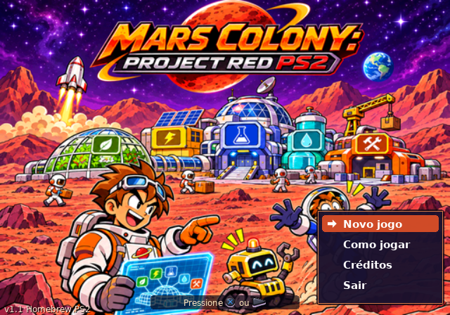
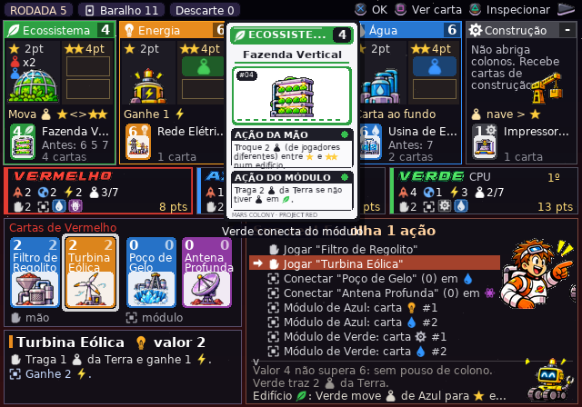
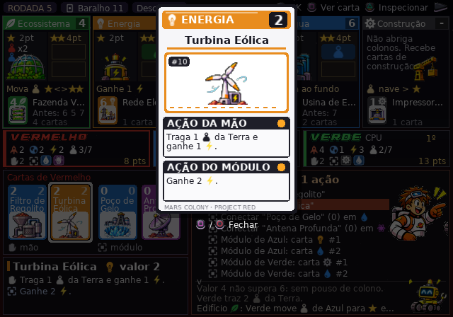
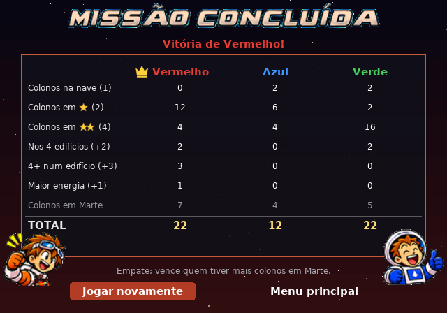

# Mars Colony: Project Red PS2

Jogo de cartas e estratégia sobre a colonização de Marte, feito como **homebrew para PlayStation 2**.
As regras foram adaptadas do livro de regras enviado (Pocket Mars). Nomes, cartas, efeitos,
arte e código deste jogo são originais.






## Como jogar no PS2 / emulador

Os arquivos prontos estão em `dist/`:

| Arquivo | Uso |
|---|---|
| `dist/MarsColony_ProjectRed_PS2.iso` | Imagem de disco: abra no **PCSX2** (ou grave para um console com OPL/desbloqueio). |
| `dist/MARSCOL.ELF` | Executável: rode pelo **uLaunchELF/wLaunchELF** (pendrive USB), pelo PS2Link ou em *Run ELF* no PCSX2. |

A ISO usa `SYSTEM.CNF` com `BOOT2 = cdrom0:\MARSCOL.ELF;1` (NTSC, 640x448). Tudo (fontes,
ícones, sons) está embutido no ELF, então não é preciso nenhum arquivo extra.

### Controles (DualShock 2)

| Botão | Ação |
|---|---|
| Direcional / analógico | Navegar nos menus e opções |
| ✕ | Confirmar |
| ○ | Voltar / **desfazer** a jogada do turno (enquanto não houve compra de cartas) |
| △ | Modo inspecionar: percorre edifícios e jogadores mostrando detalhes e pontuação |
| □ | Ver a carta em foco (ou a última carta revelada) em tamanho grande |
| L1 / R1 | Rolar listas longas |
| START | Pausa (continuar, regras, sair) |

No PC: setas, Enter/Z, Esc/X, Tab, R (ver carta), P.

## Modos

- 2 a 4 jogadores; cada vaga pode ser **Humano** ou **CPU Fácil / Normal / Difícil**.
- Vários humanos jogam em *hot-seat*: há uma tela "passe o controle" e as cartas ficam ocultas entre os turnos.
- Variante opcional de **draft** de cartas (do livro de regras).
- Velocidade da CPU: normal, rápida ou instantânea.
- Tutorial "Como jogar" com 9 páginas dentro do jogo (inclui a anatomia da carta e o mapa de botões).
- Quando a CPU joga ou revela uma carta, ela aparece em destaque por alguns instantes.

## Regras implementadas

- Preparação: 1 colono na nave, 6 na Terra, energia 1, 4 cartas (2 no módulo, 2 na mão).
- Ações do turno: jogar da mão (ação de cima); jogar do próprio módulo (conectar no edifício
  da mesma cor, pousar colono se o valor superar o de baixo ou 3, ação de baixo, habilidade do edifício);
  jogar do módulo de outro jogador (o dono usa a ação de baixo, você usa a habilidade);
  trazer 1 colono da Terra; descartar 1 carta para ganhar 1 energia (máx. 7).
- Regra das 4 cartas ao fim de cada turno, para todos os jogadores, a partir de quem jogou.
- Baralho vazio: as cartas cobertas dos edifícios mais o descarte viram um novo baralho.
- Habilidades dos 5 edifícios (Ecossistema, Energia, Ciência, Água, Construção).
- Fim da rodada com alguém tendo 7 colonos em Marte; pontuação 1/2/4, +2 (4 edifícios),
  +3 (4 colonos num edifício), +1 (maior energia, empates incluídos); desempate por colonos em Marte.

**O que eu tive que decidir:** o PDF enviado é uma versão compacta e corta alguns trechos, e o
livro não traz o texto das 35 cartas de projeto. Por isso:
- A capacidade do espaço ★★ ficou em **1 colono com 2 jogadores e 2 com 3–4 jogadores** (só o
  valor de 4 jogadores aparece no PDF).
- As **35 cartas de projeto** (5 cores × 7, valores 0–7) foram criadas para este jogo em `src/game.c`
  (tabela `CARDS`), usando os tipos de efeito que o livro mostra nos exemplos. Dá para rebalancear editando essa tabela.

## Arte

A arte enviada fica em `art_src/` (folhas das 35 cartas, key art, mascotes e prédios, fonte
cromada e botões do controle). O script `tools/gen_art.py` recorta tudo automaticamente
(remove o fundo branco, separa as letras itálicas da fonte e sintetiza os acentos Á Â Ã É Ê Í Ó Ô Õ Ú Ç)
e gera as texturas em `data/` mais as posições em `src/art.h`.

Onde cada item aparece:
- **Key art**: tela de título.
- **Ilustrações das cartas**: cartas na mão/módulo, topo das pilhas dos edifícios, carta em
  tamanho grande (□) e carta revelada pela CPU. A carta grande reproduz o layout das folhas enviadas.
- **Prédios**: dentro dos painéis dos 5 edifícios.
- **Mascotes**: astronauta apontando para as opções no seu turno, robô quando a CPU pensa,
  comemoração no fim de jogo, "joinha" na troca de jogador e na configuração.
- **Fonte cromada**: títulos das telas e nomes dos jogadores.
- **Botões do controle**: dicas na tela e página de controles.

**Orçamento de VRAM do PS2.** Depois dos framebuffers sobra ~1 MB de VRAM para texturas, por isso:
atlas de texto/ícones 512x256 RGBA (512 KB), arte 512x512 em 16 bits (512 KB) e key art + botões
512x512 em 16 bits (512 KB). Cada tela usa no máximo duas dessas texturas (≈1 MB). Isso foi
calculado a partir da configuração do SDL2 para PS2, mas não pude medir em hardware real.

Para regenerar: `make assets` (requer Pillow, numpy e scipy).

## Compilar

### PS2 (PS2SDK)

Requer o toolchain [ps2dev](https://github.com/ps2dev/ps2dev) com os *ports* (SDL2, gsKit) e o `genisoimage` para gerar a ISO.

```sh
export PS2DEV=/usr/local/ps2dev PS2SDK=$PS2DEV/ps2sdk
make -f Makefile.ps2        # dist/MARSCOL.ELF (compactado com ps2-packer)
make -f Makefile.ps2 iso    # dist/MarsColony_ProjectRed_PS2.iso
```

### PC (para testar)

```sh
sudo apt install libsdl2-dev
make            # ./marscolony e ./sim
make test       # simula milhares de partidas CPU x CPU verificando as regras
./marscolony --autotest pasta/   # gera screenshots de todas as telas
```

## Estrutura

```
src/game.c/.h    motor de regras (C puro, estado copiável, sem dependências)
src/ai.c/.h      IA da CPU (busca das jogadas do turno + heurística de pontuação)
src/render.c/.h  desenho com SDL2: atlas, texto UTF-8 com ícones embutidos
src/audio.c/.h   sintetizador de efeitos e trilha ambiente
src/main.c       telas: título, configuração, jogo, pausa, regras, fim, créditos
src/assets.h     fonte/ícones gerados por tools/gen_assets.py
src/art.h        posições da arte gerada por tools/gen_art.py
src/artdata.c    embute data/art.rle e data/title.rle no executável
art_src/         arte original enviada
tests/sim.c      simulador e verificador de invariantes
ps2/SYSTEM.CNF   boot do disco
```

## Créditos

- Mecânicas: adaptadas das regras de *Pocket Mars* (design de Michał Jagodziński, Board&Dice). Projeto de fã, sem fins comerciais.
- Arte das cartas, personagens, key art, fonte cromada e botões: fornecidos pelo autor do projeto.
- Fonte de texto DejaVu Sans (licença livre). Música e efeitos sintetizados em tempo real.
- Feito com PS2SDK, gsKit e SDL2 (port para PS2).
